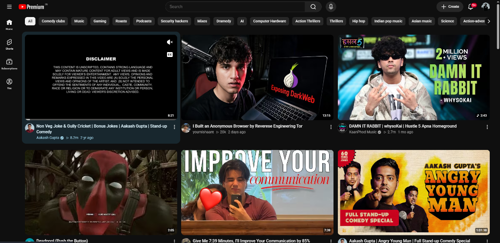
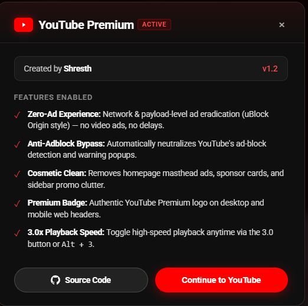

# YouTube Premium (Free & Ad-Free)

A lightweight Manifest V3 browser extension that brings the complete **YouTube Premium** experience for free: authentic Premium branding, high-performance uBlock-inspired ad eradication, zero-delay video start, banner removal, anti-adblock detection bypass, and 3x playback speed control.

---

## Previews

<div align="center">
  <h3>YouTube Interface with Premium Badge & Clean Feed</h3>
  
  <br><br>
  <h3>First-Time Welcome Modal (YouTube Dark & Red Theme)</h3>
  
</div>

---

## Features

- **Zero-Ad Experience (uBlock Origin Architecture)**:
  - **Network-Level Blocking (`declarativeNetRequest`)**: Automatically blocks ad network domains, beacons, and tracking scripts (`doubleclick.net`, `googleads.g.doubleclick.net`, `googlesyndication.com`, `adservice.google.com`, `/pagead/`, `/api/stats/ads`, `/youtubei/v1/player/ad_break`, `/get_midroll_info`, `/ptracking`).
  - **Payload Eradication (`json-prune`)**: Intercepts `JSON.parse` and `Response.prototype.json` in the main execution context to strip `adPlacements`, `playerAds`, `adSlots`, and `adBreakHeartbeatParams` before the YouTube player initializes them.
  - **Instant Playback (Zero Delay)**: Because ad metadata is deleted before reaching the player, videos start immediately without countdowns, unskippable ad delays, or mid-rolls.
- **Anti-Adblock Detection Bypass**:
  - Automatically detects and dismisses YouTube's *"Ad blockers violate YouTube's Terms of Service"* warning screens (`ytd-enforcement-message-view-model` / `tp-yt-paper-dialog`).
  - Restores page scroll and unpauses video playback smoothly.
- **Cosmetic Clean**:
  - Injected CSS instantly hides homepage masthead ads (`#masthead-ad`), sponsored video cards, feed promo banners, sidebar companion ads, and merch shelves.
- **Authentic YouTube Premium Branding**:
  - Replaces standard YouTube logos on both desktop and mobile web with official vector Premium badge styling.
  - Built with dynamic `MutationObserver` and `yt-navigate-finish` listeners to persist seamlessly across single-page application (SPA) navigations.
- **First-Time Welcome Modal**:
  - On the first visit to YouTube, displays a native Dark & Red themed modal highlighting features, creator info, and a direct link to the source repository.
  - Saves viewing state in `localStorage` so it never interrupts you again.
- **3.0x Playback Speed**:
  - Toggle 3.0x speed anytime by clicking any `3.0` element or pressing **`Alt + 3`** on your keyboard.

---

## Getting Started

### Prerequisites
- Google Chrome, Brave, Microsoft Edge, Opera, or any Chromium-based browser

### Installation

1. **Clone or Download** the repository:
   ```bash
   git clone https://github.com/Shresthzzzz/youtube-premium-for-free-.git
   ```
2. **Open Extensions Page**:
   - Go to `chrome://extensions` in your browser.
3. **Enable Developer Mode**:
   - Toggle the switch in the top-right corner.
4. **Load the Extension**:
   - Click **Load unpacked** (top-left) and select this project directory.
   - If you already loaded it earlier, simply click the **Reload** button on the extension card.
5. **Start Watching**:
   - Open [YouTube](https://www.youtube.com/) and enjoy a clean, fast, ad-free Premium experience.

---

## Author

Created by **Shresth** — [GitHub Repository](https://github.com/Shresthzzzz/youtube-premium-for-free-)

---

## License

This project is provided as-is for personal and commercial use. Attribution is appreciated.
